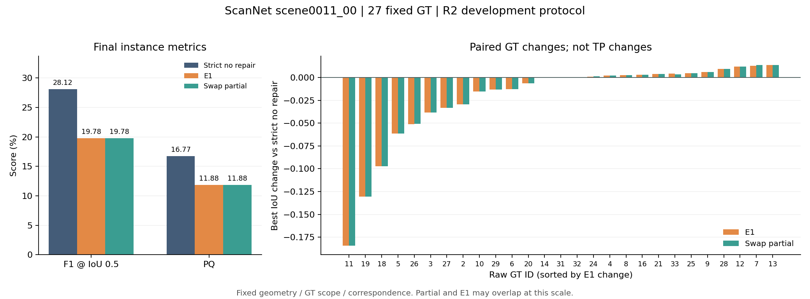

# ScanNet scene0011_00：严格一票无修复、E1 与 auto-v3-swap partial

本报告只分析已冻结输出，不修改实现、筛选或参数。唯一主基线为严格一票无修复；历史结果单独列作参考。

本场景 E1 和 partial 的 F1、PQ 均低于严格一票无修复基线，局部最佳 IoU 改善没有转化成整体收益。

[结构化分析与全部差异](analysis_scene0011_00.json) · [原始总体指标](evaluation_r2/comparison.json) · [E1 逐 GT 原始结果](evaluation_r2/paired/E1_final.json) · [partial 逐 GT 原始结果](evaluation_r2/paired/swap_partial_final.json)

本场景采用 238 个已有步长 10 帧、27 个固定可评价 GT、78,514 个可评价已观测 GT 表面顶点。三组共用 1,513,525 点的固定 TSDF、GT 范围与对应索引；各项哈希已核对。评分为 main 锁定的 object_observed_repair / revision 2，通过已批准的 ScanNet 数据适配入口调用；开发协议 frozen=false，不是官方 ScanNet 排行榜结果，也不把 Replica 350 GT 范围套用于本场景。

## 整体结果

指标以百分数展示，变化为百分点；TP/FP/FN 使用 IoU 0.5。AP/AP50 采用协议的统一置信度计算。

| 方法 | AP | AP50 | F1 | PQ | mCov | TP / FP / FN |
|---|---:|---:|---:|---:|---:|---:|
| 严格一票无修复 | 1.5199 | 8.1884 | 28.1250 | 16.7672 | 37.7899 | 9 / 28 / 18 |
| E1（swap 种子） | 0.8787 | 4.7339 | 19.7802 | 11.8818 | 35.5764 | 9 / 55 / 18 |
| auto-v3-swap partial | 0.8787 | 4.7339 | 19.7802 | 11.8820 | 35.5793 | 9 / 55 / 18 |

| 相对严格基线 | ΔAP | ΔAP50 | ΔF1 | ΔPQ | ΔmCov |
|---|---:|---:|---:|---:|---:|
| E1（swap 种子） | -0.6412 | -3.4545 | -8.3448 | -4.8854 | -2.2135 |
| auto-v3-swap partial | -0.6412 | -3.4545 | -8.3448 | -4.8853 | -2.2106 |

E1 的 TP/FN 为 9/18，基线为 9/18；FP 从 28 增至 55。精度从 24.3243% 变为 14.0625%，召回率从 33.3333% 变为 33.3333%。PQ 中的 SQ 从 59.6168% 变为 60.0691%，RQ/F1 从 28.1250% 变为 19.7802%。因此应同时检查匹配质量和额外预测数量，不能只看局部修复数。

在 IoU 0.50–0.95 的全部 AP 阈值上，E1 与基线的 TP 数相同，额外 FP 是 AP 下降的直接计分因素。这说明本次 AP 下降主要体现为精度损失，不等于每个匹配实例的 IoU 都下降。

## 逐 GT：改善个数不能替代改善幅度

E1 相对基线：13 个 GT 最佳 IoU 上升、12 个下降、2 个不变。全部正向 ΔIoU 之和为 0.075609，全部负向之和为 -0.673243；平均 ΔIoU 为 -0.022135，与 mCov 的变化一致。这里的“改善”仅指同一 GT 的最佳 IoU 增大，不能解读为新增 TP。

| E1 变化最大的 GT | 基线最佳 IoU | E1 最佳 IoU | ΔIoU |
|---|---:|---:|---:|
| 改善 / raw GT 13 | 0.570326 | 0.584048 | +0.013722 |
| 改善 / raw GT 7 | 0.528316 | 0.541155 | +0.012839 |
| 改善 / raw GT 12 | 0.478128 | 0.489939 | +0.011811 |
| 改善 / raw GT 28 | 0.631937 | 0.641515 | +0.009578 |
| 改善 / raw GT 9 | 0.521911 | 0.528046 | +0.006135 |
| 退化 / raw GT 11 | 0.397436 | 0.213162 | -0.184273 |
| 退化 / raw GT 19 | 0.427694 | 0.297103 | -0.130592 |
| 退化 / raw GT 18 | 0.282495 | 0.185339 | -0.097156 |
| 退化 / raw GT 5 | 0.360479 | 0.298883 | -0.061596 |
| 退化 / raw GT 26 | 0.310429 | 0.259443 | -0.050986 |

## 归属与结构诊断

| 已观测可评价 GT 表面 | 严格基线 | E1 | partial |
|---|---:|---:|---:|
| 正确归属顶点 | 32241 | 30537 | 30542 |
| 错误归属顶点 | 11166 | 11710 | 11710 |
| 有几何但未分配顶点 | 19143 | 20303 | 20298 |
| 无几何顶点 | 15964 | 15964 | 15964 |

主分区结构诊断（main_partition_intersection）：Split GT 从 6 变为 11，Merge 预测从 7 变为 6；partial 的对应计数为 11、6。辅助几何诊断另报告 Split GT 12→18，Merge 预测 8→8。两套诊断范围不同，不能混用。

这些计数支持“预测碎片增多、整体归属收益不足”的现象描述；尚未按种子、追踪段或撤票阶段做因果消融，不能据此认定某一具体模块是唯一原因。正确归属的对齐是评分专用的一对一最优匹配，不反馈到算法。

## partial 与 E1 的实际差异

AP、AP50、F1 的差值分别为 +0.00000000、+0.00000000、+0.00000000 个百分点；PQ 差值 +0.00015705，mCov 差值 +0.00281626 个百分点。可评价 GT 上正确归属顶点增加 5，错误归属变化 0。

按 PLY 原始 surface_index 逐点核对整个固定 TSDF，partial 相对 E1 有 146 点最终实例标签变化（占 0.009646%），其中 80 点由未分配变为已分配、66 点反向变化、0 点在不同正实例 ID 间切换；原生证据状态变化 293 点。全 TSDF 未分配点净减少 14，不等于 GT 上纠正了同样多的点。PLY 的 state 来自原生证据，instance_id 来自最终后处理；不能把两者当作同一阶段。

| raw GT（仅列 partial 与 E1 不同者） | E1 最佳 IoU | partial 最佳 IoU | ΔIoU |
|---|---:|---:|---:|
| 2 | 0.41556573 | 0.41567447 | +0.00010874 |
| 7 | 0.54115456 | 0.54189944 | +0.00074488 |
| 20 | 0.04952194 | 0.04953409 | +0.00001214 |
| 24 | 0.24350115 | 0.24400657 | +0.00050542 |
| 26 | 0.25944250 | 0.25950513 | +0.00006263 |
| 33 | 0.56769596 | 0.56702254 | -0.00067342 |

partial 的冻结策略只把旧观测计划的 whole 撤票改为现有 partial 撤票，复用同批种子、SAM2 追踪、ID、门控、可信区域、TSDF 和后处理。原 E1 重放、严格一票、全量/增量一致、精确回滚、范围外不变等已记录检查全部为 true。这些检查证明执行约束一致，不代表指标必然改善。

## 执行与复核

自动选中 65 个种子，实际执行 64 个。零有效正向投影按用户确认同步跳过并留痕，E1 与 partial 共用执行种子。
跳过 G076 / M0107 / 原始帧 2010：ZERO_VALID_FORWARD_PROJECTED_SURFACE_SUPPORT；有效深度像素 0。

最终指标与原生指标均保留在原始 comparison.json；本报告主表统一使用 final。历史 P1-A1 使用反向投影投票，本轮严格基线使用 E1 正向投影及同帧冲突弃票，旧新差值包含基线实现变化，不能作为本轮修复收益。历史 MaskClustering 也不属于这组三方法的固定几何修复对照。

所有分析输入与本地 delivery_manifest.json 的 SHA-256 一致。结构化 JSON 包含完整 27 GT 数据、各阈值 TP/FP/FN、指标差值、点级差异索引、原始输入哈希及脚本哈希；表中的 raw GT ID 不臆造语义名称。原审计键名 all_400_frames 沿用旧名称，实际帧数以本报告固定帧列表为准。

建议同时归档：evaluation_r2 中的原始 metrics/paired/adapter_manifest、protocol_freeze、confirmed_selection、partial/policy 与 predictions_freeze、三个方法的实例/未分配 PLY、本分析 JSON 及复核脚本。实现差异应与已有 E1/auto-v3 源码逐项对照，只上传实际不同的适配、配置和来源记录。

本报告不推断其他场景表现，不把“局部最佳 IoU 改善”解释为整体算法有效，也不据此修改参数。
