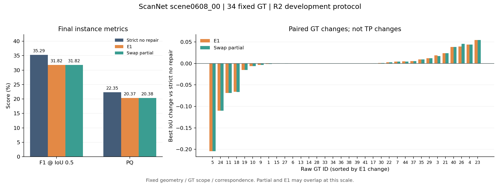

# ScanNet scene0608_00：严格一票无修复、E1 与 auto-v3-swap partial

本报告只分析已冻结输出，不修改实现、筛选或参数。唯一主基线为严格一票无修复；历史结果单独列作参考。

本场景 E1 和 partial 的 F1、PQ 均低于严格一票无修复基线，局部最佳 IoU 改善没有转化成整体收益。

[结构化分析与全部差异](analysis_scene0608_00.json) · [原始总体指标](evaluation_r2/comparison.json) · [E1 逐 GT 原始结果](evaluation_r2/paired/E1_final.json) · [partial 逐 GT 原始结果](evaluation_r2/paired/swap_partial_final.json)

本场景采用 339 个已有步长 10 帧、34 个固定可评价 GT、54,224 个可评价已观测 GT 表面顶点。三组共用 1,458,730 点的固定 TSDF、GT 范围与对应索引；各项哈希已核对。评分为 main 锁定的 object_observed_repair / revision 2，通过已批准的 ScanNet 数据适配入口调用；开发协议 frozen=false，不是官方 ScanNet 排行榜结果，也不把 Replica 350 GT 范围套用于本场景。

## 整体结果

指标以百分数展示，变化为百分点；TP/FP/FN 使用 IoU 0.5。AP/AP50 采用协议的统一置信度计算。

| 方法 | AP | AP50 | F1 | PQ | mCov | TP / FP / FN |
|---|---:|---:|---:|---:|---:|---:|
| 严格一票无修复 | 3.5015 | 15.1660 | 35.2941 | 22.3488 | 53.0467 | 21 / 64 / 13 |
| E1（swap 种子） | 3.3279 | 13.1542 | 31.8182 | 20.3681 | 52.4086 | 21 / 77 / 13 |
| auto-v3-swap partial | 3.3279 | 13.1542 | 31.8182 | 20.3756 | 52.4237 | 21 / 77 / 13 |

| 相对严格基线 | ΔAP | ΔAP50 | ΔF1 | ΔPQ | ΔmCov |
|---|---:|---:|---:|---:|---:|
| E1（swap 种子） | -0.1735 | -2.0118 | -3.4759 | -1.9807 | -0.6381 |
| auto-v3-swap partial | -0.1735 | -2.0118 | -3.4759 | -1.9732 | -0.6230 |

E1 的 TP/FN 为 21/13，基线为 21/13；FP 从 64 增至 77。精度从 24.7059% 变为 21.4286%，召回率从 61.7647% 变为 61.7647%。PQ 中的 SQ 从 63.3215% 变为 64.0141%，RQ/F1 从 35.2941% 变为 31.8182%。因此应同时检查匹配质量和额外预测数量，不能只看局部修复数。

E1 与基线并非所有 AP 阈值的 TP 数都相同；各阈值的 TP/FP/FN 全量数据保存在结构化 JSON，应同时检查不同 IoU 阈值的匹配收益与额外预测的惩罚。

IoU 0.55 的 TP 从 17→18，0.60 从 13→14，0.65 从 9→11；其中 0.60、0.65 的单阈值 AP 略升，但不足以抵消其他阈值的损失，最终平均 AP 仍下降。这与第一场景的“所有 AP 阈值 TP 数不变”不同。

## 逐 GT：改善个数不能替代改善幅度

E1 相对基线：14 个 GT 最佳 IoU 上升、10 个下降、10 个不变。全部正向 ΔIoU 之和为 0.259193，全部负向之和为 -0.476138；平均 ΔIoU 为 -0.006381，与 mCov 的变化一致。这里的“改善”仅指同一 GT 的最佳 IoU 增大，不能解读为新增 TP。

partial 相对严格基线为 15 升、9 降、10 不变，正向 ΔIoU 总和 0.263969、负向总和 -0.475798。两种修复均有 raw GT 40 的最佳 IoU 从 0.480769 升至 0.519231，同时 raw GT 5 从 0.541606 降至 0.337331。因此总 TP 数相同不能理解为每个 GT 的匹配状态都相同；这些越界记录本身仍是最佳 IoU 诊断，TP 计数以原始一对一评分为准。

| E1 变化最大的 GT | 基线最佳 IoU | E1 最佳 IoU | ΔIoU |
|---|---:|---:|---:|
| 改善 / raw GT 23 | 0.545455 | 0.600000 | +0.054545 |
| 改善 / raw GT 4 | 0.626147 | 0.670091 | +0.043945 |
| 改善 / raw GT 26 | 0.560924 | 0.600418 | +0.039494 |
| 改善 / raw GT 40 | 0.480769 | 0.519231 | +0.038462 |
| 改善 / raw GT 21 | 0.446588 | 0.470414 | +0.023827 |
| 退化 / raw GT 5 | 0.541606 | 0.337331 | -0.204275 |
| 退化 / raw GT 24 | 0.321429 | 0.211538 | -0.109890 |
| 退化 / raw GT 11 | 0.383046 | 0.314149 | -0.068897 |
| 退化 / raw GT 18 | 0.338070 | 0.271908 | -0.066162 |
| 退化 / raw GT 19 | 0.529744 | 0.514651 | -0.015093 |

## 归属与结构诊断

| 已观测可评价 GT 表面 | 严格基线 | E1 | partial |
|---|---:|---:|---:|
| 正确归属顶点 | 29319 | 28989 | 28970 |
| 错误归属顶点 | 3429 | 3857 | 3861 |
| 有几何但未分配顶点 | 7896 | 7798 | 7813 |
| 无几何顶点 | 13580 | 13580 | 13580 |

主分区结构诊断（main_partition_intersection）：Split GT 从 16 变为 18，Merge 预测从 3 变为 3；partial 的对应计数为 16、2。辅助几何诊断另报告 Split GT 28→29，Merge 预测 8→7。两套诊断范围不同，不能混用。

E1 的主分区 Split GT 增多，而 partial 的 Split GT 回到基线数量、Merge 预测低于基线；但两种修复的 FP 都增加，整体 F1/PQ 仍下降，不能用单一结构指标判断修复成功。尚未按种子、追踪段或撤票阶段做因果消融，不能据此认定某一具体模块是唯一原因。正确归属的对齐是评分专用的一对一最优匹配，不反馈到算法。

## partial 与 E1 的实际差异

AP、AP50、F1 的差值分别为 +0.00000000、+0.00000000、+0.00000000 个百分点；PQ 差值 +0.00749177，mCov 差值 +0.01504758 个百分点。可评价 GT 上正确归属顶点变化 -19，错误归属变化 +4，有几何但未分配顶点变化 +15。partial 的 PQ/mCov 虽然略升，正确归属总顶点数却下降；二者分别受实例 IoU 与表面顶点归属影响，不能视作同一收益。

按 PLY 原始 surface_index 逐点核对整个固定 TSDF，partial 相对 E1 有 893 点最终实例标签变化（占 0.061218%），其中 273 点由未分配变为已分配、620 点反向变化、0 点在不同正实例 ID 间切换；原生证据状态变化 1151 点。全 TSDF 未分配点净变化 +347，不等于 GT 上纠正了同样多的点。PLY 的 state 来自原生证据，instance_id 来自最终后处理；不能把两者当作同一阶段。

| raw GT（仅列 partial 与 E1 不同者） | E1 最佳 IoU | partial 最佳 IoU | ΔIoU |
|---|---:|---:|---:|
| 3 | 0.65778160 | 0.65649183 | -0.00128977 |
| 15 | 0.08119971 | 0.08252191 | +0.00132220 |
| 18 | 0.27190786 | 0.27140711 | -0.00050075 |
| 26 | 0.60041841 | 0.60669456 | +0.00627615 |
| 27 | 0.67445720 | 0.67441539 | -0.00004181 |
| 30 | 0.43931019 | 0.43908910 | -0.00022109 |
| 44 | 0.36731255 | 0.36688380 | -0.00042875 |

partial 的冻结策略只把旧观测计划的 whole 撤票改为现有 partial 撤票，复用同批种子、SAM2 追踪、ID、门控、可信区域、TSDF 和后处理。原 E1 重放、严格一票、全量/增量一致、精确回滚、范围外不变等已记录检查全部为 true。这些检查证明执行约束一致，不代表指标必然改善。

## 执行与复核

自动选中 154 个种子，实际执行 151 个。零有效正向投影按用户确认同步跳过并留痕，E1 与 partial 共用执行种子。
跳过 G091 / M0176 / 原始帧 1430：ZERO_VALID_FORWARD_PROJECTED_SURFACE_SUPPORT；有效深度像素 0。
跳过 G127 / M0241 / 原始帧 1430：ZERO_VALID_FORWARD_PROJECTED_SURFACE_SUPPORT；有效深度像素 0。
跳过 G212 / M0395 / 原始帧 1430：ZERO_VALID_FORWARD_PROJECTED_SURFACE_SUPPORT；有效深度像素 0。

经用户批准，裁剪/噪声过滤后重新分组沿用已有 SAM-only 来源规则。裁剪后排除整掩码 M0138、M0141、M0163，合计移除 11 条 CropFormer 来源记录；候选从 435 个变为 432 个，噪声过滤后无新增来源排除。掩码像素和数值阈值不变，E1 与 partial 共用筛选结果。完整排除证据、固定主掩码与关联边保存在 [来源过滤记录](v1/semantic_exclusions.json)，批准记录见 [regroup_source_approval.json](regroup_source_approval.json)。

最终指标与原生指标均保留在原始 comparison.json；本报告主表统一使用 final。历史 P1-A1 使用反向投影投票，本轮严格基线使用 E1 正向投影及同帧冲突弃票，旧新差值包含基线实现变化，不能作为本轮修复收益。历史 MaskClustering 也不属于这组三方法的固定几何修复对照。

所有分析输入与本地 delivery_manifest.json 的 SHA-256 一致。结构化 JSON 包含完整 34 GT 数据、各阈值 TP/FP/FN、指标差值、点级差异索引、原始输入哈希及脚本哈希；表中的 raw GT ID 不臆造语义名称。原审计键名 all_400_frames 沿用旧名称，实际帧数以本报告固定帧列表为准。

建议同时归档：evaluation_r2 中的原始 metrics/paired/adapter_manifest、protocol_freeze、confirmed_selection、partial/policy 与 predictions_freeze、三个方法的实例/未分配 PLY、本分析 JSON 及复核脚本。实现差异应与已有 E1/auto-v3 源码逐项对照，只上传实际不同的适配、配置和来源记录。

本报告不推断其他场景表现，不把“局部最佳 IoU 改善”解释为整体算法有效，也不据此修改参数。
